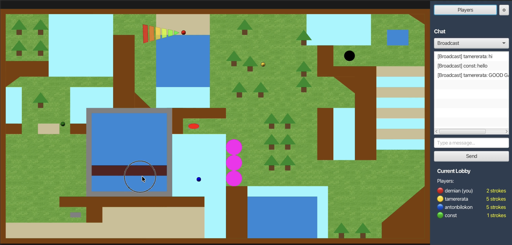

# GOLFIT – Real-time multiplayer minigolf

> Project for the **Programmierprojekt (cs108)** course, University of Basel, Spring Semester 2026 (FS26) – Group 4.

| | Link |
|---|---|
| 🌐 **Project website** | https://demian1910.github.io/golfit-website/ |
| 💻 **Source code + full commit history** | https://github.com/Demian1910/golfit |
| 🖥️ **Website repository** | https://github.com/Demian1910/golfit-website |
| 📦 **Full source code (.zip)** | https://demian1910.github.io/golfit-website/golfit-source.zip |
| 📖 **Game manual (PDF)** | https://demian1910.github.io/golfit-website/Manual.pdf |
| 🎬 **Gameplay video** | https://demian1910.github.io/golfit-website/gameplay.mp4 |
| 🗂️ **Original development repository** | University of Basel GitLab – `cs108-fs26/Gruppe-4` (restricted access) |

**Team:** Anton Bilokon · Demian Piodi · Tamer Erata · Constantin Chau

---

## 1. What is GolfIt

GolfIt is a **multiplayer minigolf** video game for up to **4 players per match**. Unlike classic turn-based minigolf, the team decided early on (diary, 3 March 2026) to make it **real-time**: all players shoot at the same time on the same course, and the player who sinks the ball with the **fewest strokes** wins; on a tie, the player who reached the hole **first** wins.

The course contains different terrains (grass, sand, ice, water, bouncy surfaces) and interactive obstacles (walls, trees, bridge, barrier, switch) that change how the ball moves.



---

## 2. What was built

### Gameplay
- **Server-side ball physics**: different friction for each terrain, wall bounces with angle of reflection, capped maximum speed, and stopping below a minimum velocity.
- **Collision sub-stepping** so a fast ball does not "tunnel" through thin walls (`ServerBall`).
- **Interactive environment**: trees that break after one hit, a switch that makes the bridge and barrier appear/disappear, and water that sends the ball back to where the stroke started.
- **Cone-shaped aim indicator**: segments grow in number and shift from green to red with shot power, and rotate with the shot direction; a shot can only be charged while the ball is stationary.
- **Unique ball colors** for each player (6 colors), assigned by lobby join order and synchronized across all clients.
- **Stroke counting, end of game and ranking**: the server determines the winner and stores results persistently (`results.csv`); the **high score** list is shown at the end of each match as a scrollable list with timestamps and every player's strokes.
- **Gamepad support** (Jamepad library), programmatically generated **sound effects**, and a **cheat code** (`HESOYAM`, which teleports the ball into the hole).

### Multiplayer, lobbies and chat
- Login for an arbitrary number of clients, unique nicknames (`Anton` → `Anton_001`), nickname suggestion based on the system username, and nickname changes.
- Lobbies (max 10, max 4 players each, status *open / running / full*), host reassignment when the creator leaves, and automatic deletion of empty lobbies.
- **Global**, **lobby** and **private** (whisper) chat, with slash commands: `/help`, `/whoami`, `/changeUsername`, `/whisper`, `/q`.
- Settings menu: nickname, sound on/off with volume, preferred ball color.

### Networking: a hand-made UDP protocol
The technical core of the project is a **text-based network protocol built on top of UDP**, documented in [`docs/networkProtocol.md`](docs/networkProtocol.md). Every message has 5 fields:

```
<type>|<channel>|<senderId>|<sequence>|<payload>\n
SYS_CONNECT|CH_SYSTEM|0|0|Anton
```

| Channel | Reliable | Used for |
|---|---|---|
| `CH_SYSTEM` | ✅ (ACK + retransmission) | login, lobbies, game state |
| `CH_CHAT` | ✅ | chat messages |
| `CH_MOVEMENT` | ❌ (fire-and-forget) | ball positions |
| `CH_PINGS` | ❌ | ping/pong and disconnect |

On reliable channels every packet is kept pending until a `SYS_ACK` arrives; if the timeout (2 s) expires it is resent, up to 3 times. A periodic ping detects lost connections.

---

## 3. Architecture

```
                ┌───────────────────────────── Server (authoritative) ────────────────────────────┐
  UDP           │ Server ─► ClientHandler ─► SystemHandler / MovementHandler ─► ServerApi          │
 ◄────────────► │                                   │                                              │
 MOVE_INPUT     │                     ServerGameSimulation (tick every 40 ms, one map per lobby)  │
 MOVE_UPDATE    │                                   └─► ServerBall (physics, collisions, strokes) │
                └──────────────────────────────────────────────────────────────────────────────────┘
                ┌──────────────────────────────────── Client ───────────────────────────────────────┐
                │ Client / ClientApi ─► handlers ─► EventBus ─► JavaFX GUI (SplashView, LobbyMenu,  │
                │                                               Sidebar+Chat, GameView, AimIndicator)│
                └────────────────────────────────────────────────────────────────────────────────────┘
                                 shared/: Protocol, Channel, ChannelManager,
                                 MessageBuilder, MessageParser, MapData, Constants
```

- **Server** – the single source of truth: manages clients, lobbies, physics and scores.
- **Client** – JavaFX interface, input (mouse/gamepad), rendering, CLI (JLine); talks to the GUI through a publish/subscribe **EventBus**.
- **Shared** – code used by both sides: protocol, channel management, message parser/builder, map data.

Source layout (`src/main/java/org/golfit/`, ~7,000 lines of Java):

| Package | Contents |
|---|---|
| `server/` | `Server`, `ClientHandler`, handlers, `ServerApi`, `game/ServerGameSimulation`, `game/ServerBall` |
| `client/` | `Client`, `ClientApi`, `eventBus/`, `game/` (GameView, Ball, AimIndicator, GamepadInput), `gui/` (SplashView, LobbyMenu, Sidebar, Settings), `sound/`, `cli/` |
| `shared/` | `protocol/` (Protocol, Channel, ChannelManager), `messageBuilder/`, `messageParser/`, `lobby/`, `constants/` (Constants, MapData) |
| `graphics/` | rendering of the course and obstacles (`Course`, `AddObstacle`, `Window`) |

---

## 4. Technology

| Area | Tool |
|---|---|
| Language | Java 25 |
| GUI | JavaFX 25 |
| Build | Gradle (wrapper), `build-cs108` task for an executable JAR + Javadoc |
| Logging | SLF4J + Logback |
| Extra libraries | JLine (console), Jamepad (gamepad) |
| Testing | JUnit 5 – 11 test classes, 111 tests (protocol, physics, EventBus, settings, sound…) |
| Quality | JaCoCo (coverage), SpotBugs, `metrics-report` task with history in `documentation/qa-history/` |
| CI | GitLab CI: builds the JAR and runs the tests on every push |

---

## 5. How to run it

Requires **Java 25**.

```bash
./gradlew build-cs108
```

```bash
java -jar build/libs/golfit-0.0.1-ALPHA.jar server 8090
```

```bash
java -jar build/libs/golfit-0.0.1-ALPHA.jar client 127.0.0.1:8090 Demian
```

The full gameplay instructions are in the [manual](https://demian1910.github.io/golfit-website/Manual.pdf).

---

## 6. The work done: milestones and diary

The project was developed from late February to late May 2026 (more than 200 commits), following the course milestones. The full diary is in [`docs/diary.md`](docs/diary.md).

| Milestone | Results | Documents |
|---|---|---|
| **MS1** – Idea and plan | Name *GOLFIT*, game concept and rules, mock-up, first UDP client/server prototype, first version of the protocol | [`docs/MS1/`](docs/MS1) – Game Concept, Project Plan, Timeline, Presentation, Requirement Analysis |
| **MS2** – Networking basics | Human-readable protocol, ping, login/logout, unique nicknames, chat, ball physics prototype, game window and course graphics | [`docs/MS2/`](docs/MS2) – Requirement Analysis, graphics requirements, course layout |
| **MS3/MS4** – Playable game | Lobbies, broadcast/whisper, chat GUI, server-side game logic, bounces and collisions, stroke counting, end of game, persistent results, SplashView, manual | [`docs/MS4/`](docs/MS4) – Manual, QA concept, Project plan, Timeline, Presentation |
| **MS5/MS6** – Final version | Cone aim indicator, interactive environment (trees, switch, bridge/barrier), unique colors, gamepad, sounds, settings, improved high score, unit tests, QA report, outreach folder, website | [`docs/MS6/`](docs/MS6) – QA Report, M6 Presentation; [`outreach/`](outreach) |

### Who did what

| Member | Main contributions |
|---|---|
| **Anton Bilokon** | Project structure, UDP network protocol and reliable channels, ping, server-side lobbies and chat, player/lobby lists, build script and CLI, server-side persistent high score, gamepad, Gradle library management |
| **Demian Piodi** | Game concept and rules, mock-up, ball physics prototype, server-side game logic and game state (match start, strokes, end of game, winner with tie-break), SplashView, cone aim indicator, unique ball colors, high score GUI, manual, logo, screenshot, video, outreach and the **website** |
| **Tamer Erata** | Login/logout, nicknames (`whoami`, `bob_001`, name change), chat and sidebar GUI, slash commands, lobby fixes, settings, sounds, unit tests and Javadoc |
| **Constantin Chau** | Graphics requirements, game window and course graphics, bounce/collision logic and friction, interactive obstacles (trees, switch, bridge, barrier), timeline, progress report, QA concept and QA report |

---

## 7. The website

The website [demian1910.github.io/golfit-website](https://demian1910.github.io/golfit-website/) is a static page (HTML + CSS) published with **GitHub Pages** from the [Demian1910/golfit-website](https://github.com/Demian1910/golfit-website) repository. It grew out of the [`outreach/`](outreach) folder required by the course and contains:

- an introduction to the game and its architecture;
- a gameplay video and a screenshot;
- a list of the main features;
- downloads of the **source code** (`golfit-source.zip`) and the **manual** (`Manual.pdf`);
- step-by-step instructions to build and start the server and the client.

---

## 8. Documentation in the repository

| File | Contents |
|---|---|
| [`README.md`](README.md) | Short project overview |
| [`docs/networkProtocol.md`](docs/networkProtocol.md) | Full network protocol specification |
| [`docs/diary.md`](docs/diary.md) | Project diary with all meetings and task assignments |
| [`docs/MS1`](docs/MS1) … [`docs/MS6`](docs/MS6) | Documents submitted at each milestone |
| [`documentation/qa-history/`](documentation/qa-history) | History of quality reports (JaCoCo coverage, SpotBugs, Javadoc warnings) |
| [`outreach/`](outreach) | Website, manual, logo, screenshot, video, `game.properties` |
